[← Kembali ke README](README.md) | [Fase Berikutnya: Agent Linux & Windows →](02-agent-linux-dan-windows.md)

---

# Fase 1 — Setup & Instalasi Infrastruktur Elastic Stack

**Platform:** Home Lab (VirtualBox, bukan platform CTF/challenge)
**Kategori:** Infrastructure Build
**Tools:** VirtualBox 7.x, Ubuntu Server 24.04.4 LTS, Elasticsearch 9.5.5, Kibana 9.5.5

---

## Ringkasan Eksekutif

Fase ini membangun seluruh infrastruktur dasar lab: satu VM server (`elastic-server`) dengan Elasticsearch dan Kibana terinstal manual di atas Ubuntu Server 24.04, dikonfigurasi dengan IP statis di jaringan internal VirtualBox (Host-only), serta Fleet Server untuk menerima koneksi dari agent di endpoint lain. Seluruh instalasi dilakukan manual (bukan unattended) agar setiap langkah dan konsekuensinya dipahami, bukan sekadar dijalankan otomatis. Fase ini menjadi fondasi bagi seluruh investigasi di fase-fase berikutnya.

---

## Arsitektur Jaringan

| Komponen | Detail |
|---|---|
| Jaringan internal lab | VirtualBox Host-only (`192.168.56.0/24`) |
| Jaringan internet tiap VM | VirtualBox NAT (`10.0.2.0/24`) |
| IP `elastic-server` | `192.168.56.10` (statis) |
| Host Windows | `192.168.56.1` |

Tiap VM dikonfigurasi dengan dua adapter jaringan: Adapter 1 (NAT) untuk akses internet saat instalasi paket, Adapter 2 (Host-only) untuk komunikasi antar-VM di dalam lab. Prinsip pemilihannya: NAT memberi jalur keluar ke internet namun mengisolasi antar-VM (setiap VM NAT mendapat IP yang sama, `10.0.2.15`), sedangkan Host-only menjadi satu-satunya jalur yang menghubungkan seluruh VM dan host Windows dalam satu subnet.

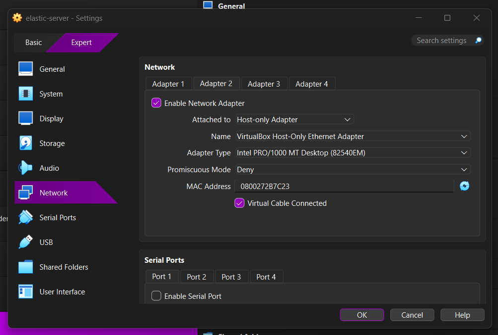
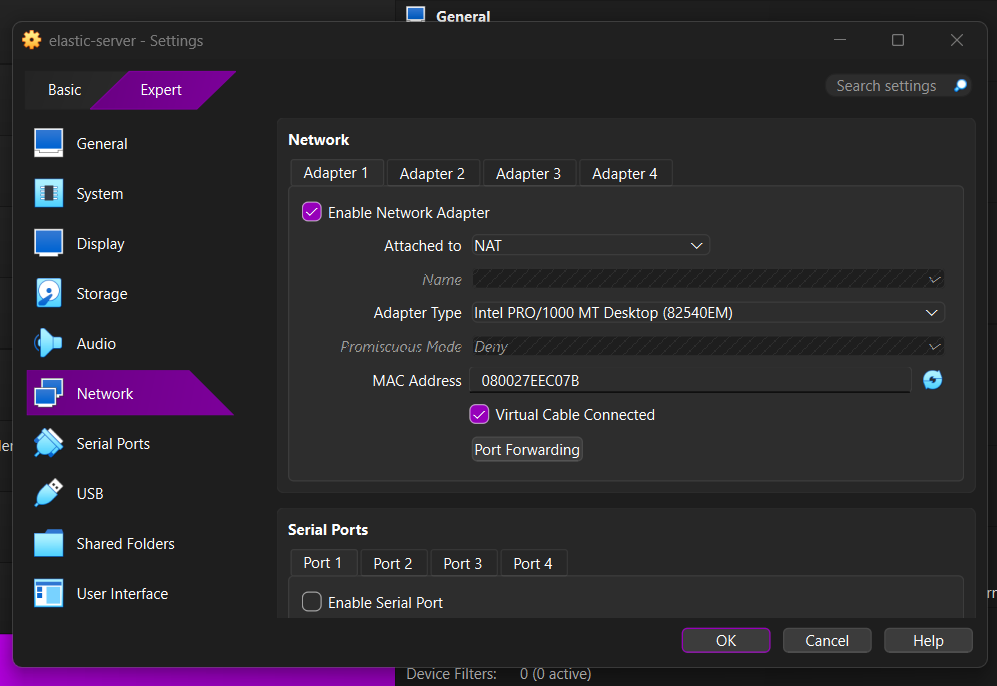

---

## Proses Investigasi

### Fase 1.1: Pembuatan VM dan Instalasi Ubuntu Server

- **Masalah:** Dibutuhkan server baru yang terisolasi dari VM Wazuh Manager yang sudah ada, agar tidak ada konflik resource maupun konfigurasi.
- **Investigasi:** Dibuat VM baru (`elastic-server`) dengan spesifikasi 8 GB RAM, 4 CPU, disk 50 GB (dynamically allocated), menggunakan ISO Ubuntu Server 24.04.4 baru — bukan instalasi *unattended*, agar setiap tahap wizard (partisi disk, network, SSH) dipahami secara sadar.
- **Temuan:** Instalasi *guided storage* default Ubuntu hanya mengalokasikan ~24 GB dari 48 GB yang tersedia di LVM volume group, menyisakan *free space* yang tidak terpakai.
- **Kesimpulan:** Ukuran partisi root (`/`) diperbesar manual ke ~48 GB saat instalasi, karena Elasticsearch menyimpan seluruh data index di `/var/lib/elasticsearch` dan memiliki mekanisme *disk watermark* yang akan menolak ingest data baru jika disk mendekati penuh.

```
Spesifikasi VM elastic-server:
- RAM: 8192 MB | CPU: 4 core | Disk: 50 GB (dynamic, LVM, diperbesar manual ke ~48GB usable)
- OS: Ubuntu Server 24.04.4 LTS (instalasi manual, OpenSSH server diaktifkan)
```

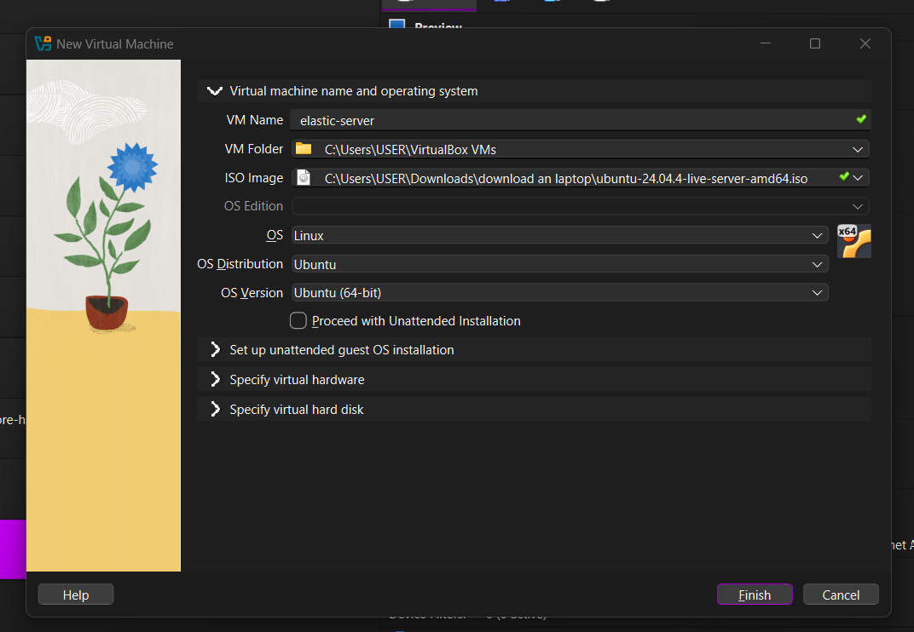
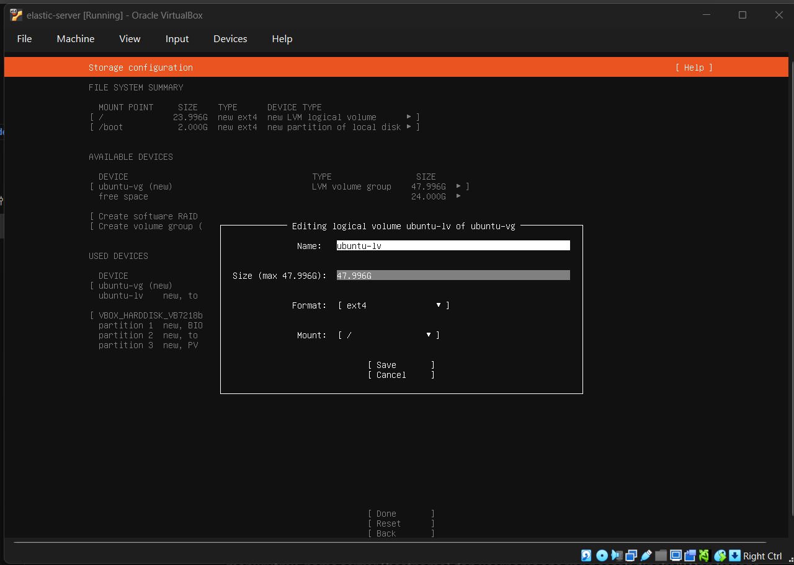
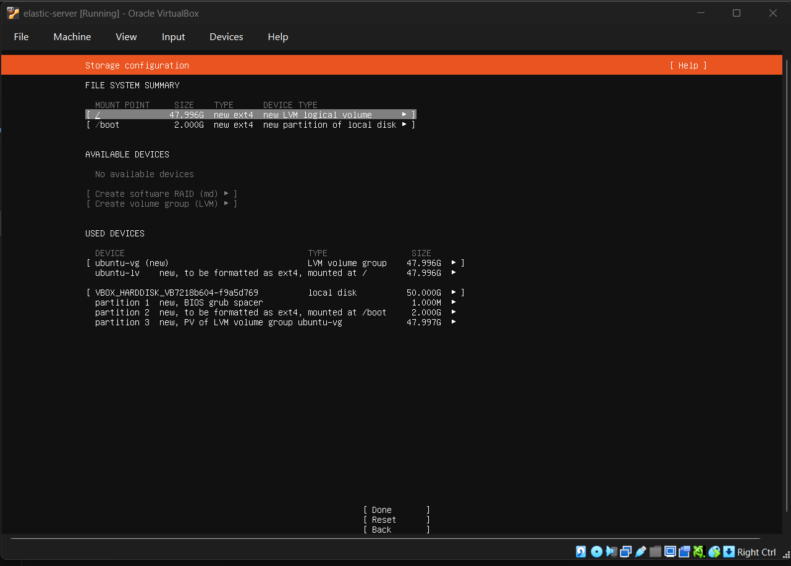

---

### Fase 1.2: Konfigurasi IP Statis

- **Masalah:** IP Host-only dari DHCP bisa berubah sewaktu-waktu, padahal server ini harus menjadi alamat tetap tujuan log dari seluruh endpoint.
- **Investigasi:** File netplan (`/etc/netplan/50-cloud-init.yaml`) diedit untuk mematikan DHCP pada interface Host-only (`enp0s8`) dan menetapkan IP statis `192.168.56.10/24`, sementara interface NAT (`enp0s3`) tetap dibiarkan DHCP karena tidak memerlukan gateway internal.
- **Temuan:** Konfigurasi diterapkan dengan `netplan try` (bukan langsung `apply`) sebagai mekanisme pengaman — perubahan otomatis dibatalkan dalam 120 detik jika tidak dikonfirmasi, menghindari risiko terkunci dari akses jaringan akibat salah konfigurasi.
- **Kesimpulan:** IP statis terbukti bertahan setelah beberapa kali reboot VM di hari-hari berikutnya, mengonfirmasi `cloud-init` tidak menimpa ulang konfigurasi jaringan pada instalasi ini.

```yaml
network:
  version: 2
  ethernets:
    enp0s3:
      dhcp4: true
    enp0s8:
      dhcp4: false
      addresses:
        - 192.168.56.10/24
```

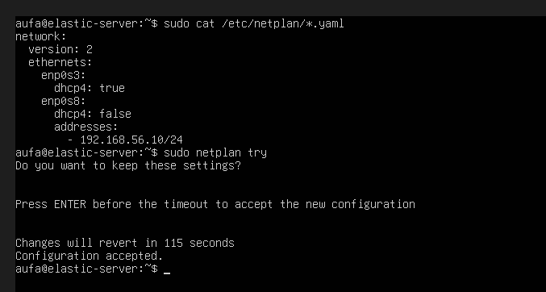
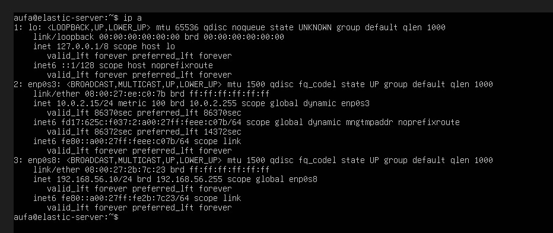
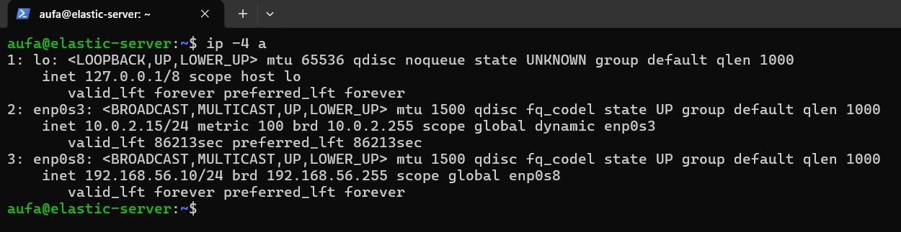

---

### Fase 1.3: Instalasi Elasticsearch

- **Masalah:** Paket Elasticsearch tidak tersedia di repository default Ubuntu.
- **Investigasi:** Repository resmi Elastic ditambahkan secara manual: impor GPG key dengan `gpg --dearmor`, tambah source list `/etc/apt/sources.list.d/elastic-9.x.list` mengacu ke `artifacts.elastic.co/packages/9.x/apt`, lalu `apt install elasticsearch`.
- **Temuan:** Instalasi otomatis menghasilkan password acak user `elastic` (ditampilkan sekali di terminal) dan mengaktifkan security (`xpack.security.enabled: true`) serta TLS (`http.ssl.enabled: true`) secara default — tidak perlu konfigurasi manual tambahan.
- **Kesimpulan:** Elasticsearch terverifikasi berjalan dan menjawab di port 9200 melalui HTTPS, baik dari `localhost` maupun dari IP Host-only (dibuktikan dengan `curl` dari host Windows menggunakan flag `-k` karena sertifikat self-signed).

```bash
# Impor GPG key dan tambahkan repository resmi Elastic
curl -fsSL https://artifacts.elastic.co/GPG-KEY-elasticsearch | \
  sudo gpg --dearmor -o /usr/share/keyrings/elasticsearch-keyring.gpg
echo "deb [signed-by=/usr/share/keyrings/elasticsearch-keyring.gpg] \
  https://artifacts.elastic.co/packages/9.x/apt stable main" | \
  sudo tee /etc/apt/sources.list.d/elastic-9.x.list

sudo apt update && sudo apt install elasticsearch

# Verifikasi dari dalam server, lewati verifikasi CA lokal via flag --cacert
sudo curl --cacert /etc/elasticsearch/certs/http_ca.crt -u elastic https://localhost:9200
```

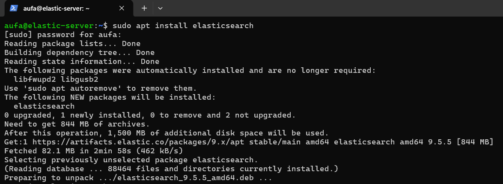
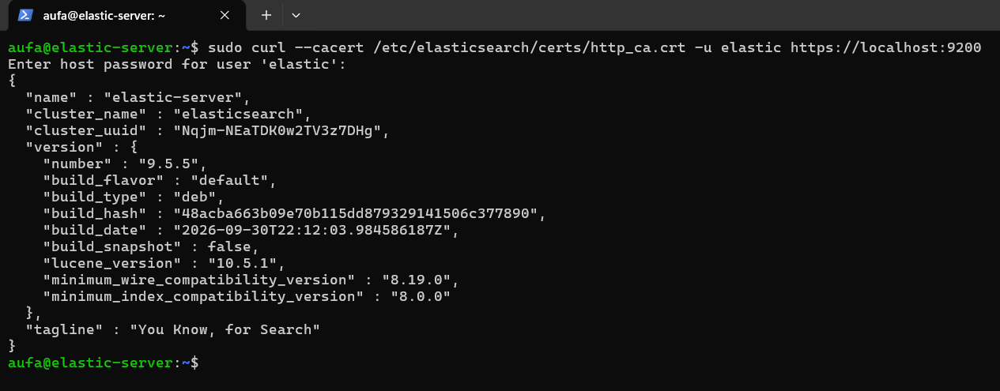
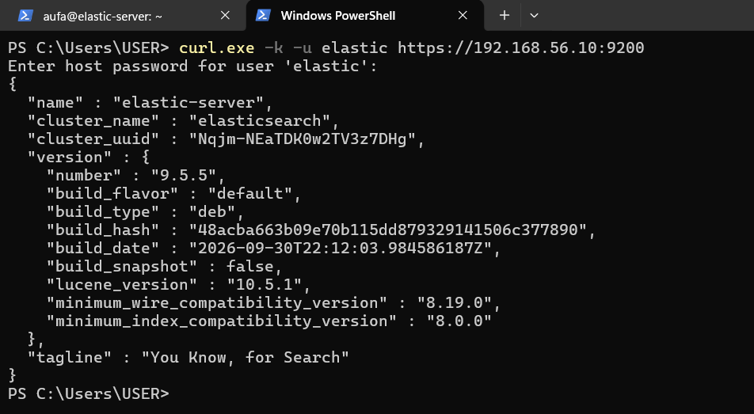

---

### Fase 1.4: Instalasi Kibana & Perbaikan Akses Jaringan

- **Masalah:** Konfigurasi default Kibana hanya mendengarkan koneksi di `localhost`, sehingga tidak bisa diakses dari browser host Windows.
- **Investigasi:** Parameter `server.host` di `/etc/kibana/kibana.yml` diubah dari default menjadi `"192.168.56.10"`, lalu service di-restart.
- **Temuan:** Kibana baru terhubung ke Elasticsearch setelah proses *enrollment* (menempelkan enrollment token dari Elasticsearch, lalu memasukkan *verification code* 6 digit yang diambil lewat `kibana-verification-code`).
- **Kesimpulan:** Dashboard Kibana berhasil diakses dari browser host Windows di `http://192.168.56.10:5601` setelah login dengan user `elastic`.

```bash
sudo apt install kibana
# Edit server.host di /etc/kibana/kibana.yml menjadi "192.168.56.10"
sudo systemctl enable --now kibana

# Buat enrollment token dari sisi Elasticsearch (berlaku 30 menit)
sudo /usr/share/elasticsearch/bin/elasticsearch-create-enrollment-token -s kibana

# Ambil verification code dari sisi Kibana
sudo /usr/share/kibana/bin/kibana-verification-code
```

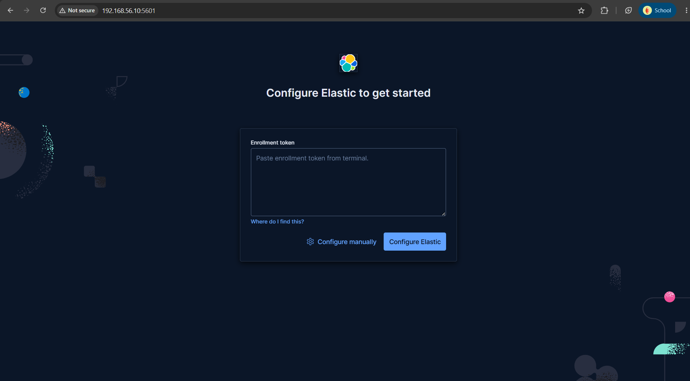
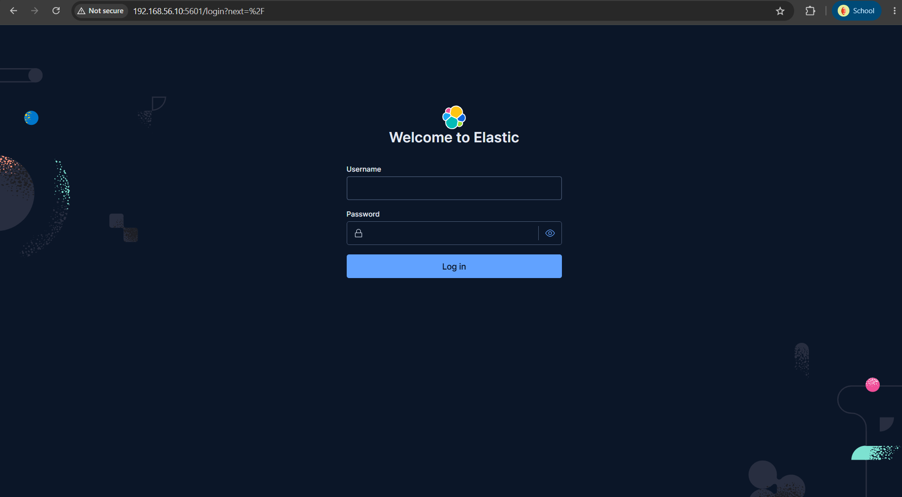

---

### Fase 1.5: Fleet Server & Agent Policy

- **Masalah:** Fleet tidak bisa diinisialisasi dengan pesan error `Agent binary source needs encrypted saved object api key to be set`.
- **Investigasi:** Kibana memerlukan *encryption key* permanen (`xpack.encryptedSavedObjects.encryptionKey` dan dua key terkait lainnya) yang tidak otomatis dibuat saat *enrollment* awal. Key digenerate dengan `kibana-encryption-keys generate` dan ditempel manual ke `kibana.yml`.
- **Temuan:** Setelah Fleet aktif, Fleet Server di-install di mesin `elastic-server` sendiri menggunakan flag `ELASTIC_AGENT_FLAVOR=servers`, dengan URL publik `https://192.168.56.10:8220` sebagai titik yang akan dihubungi agent-agent lain.
- **Kesimpulan:** Fleet Server berhasil **Healthy**, dan dua agent policy dibuat untuk memisahkan konfigurasi: `policy-endpoint-windows` dan `policy-endpoint-linux`, masing-masing dengan integrasi *System* (log & metrik OS) aktif.

```bash
# Generate encryption key, tempel hasilnya ke /etc/kibana/kibana.yml
sudo /usr/share/kibana/bin/kibana-encryption-keys generate
sudo systemctl restart kibana

# Install Fleet Server di mesin yang sama dengan Elasticsearch
sudo ELASTIC_AGENT_FLAVOR=servers dpkg -i elastic-agent-9.5.5-amd64.deb
sudo elastic-agent enroll \
  --fleet-server-es=https://10.0.2.15:9200 \
  --fleet-server-service-token=<REDACTED> \
  --fleet-server-policy=fleet-server-policy \
  --fleet-server-es-ca-trusted-fingerprint=<REDACTED> \
  --fleet-server-port=8220
```

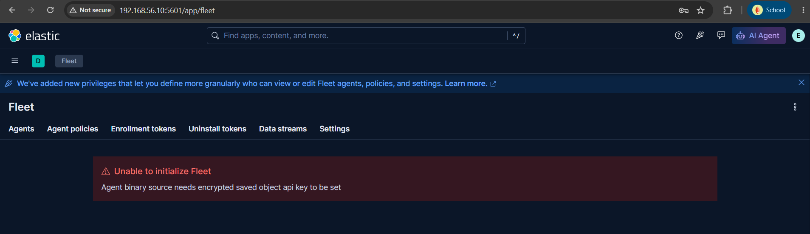
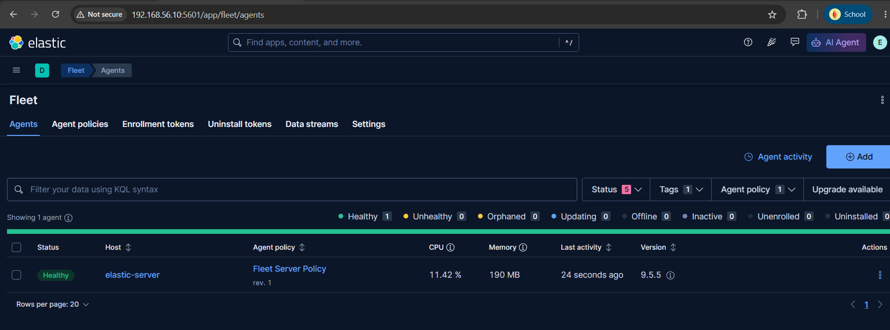
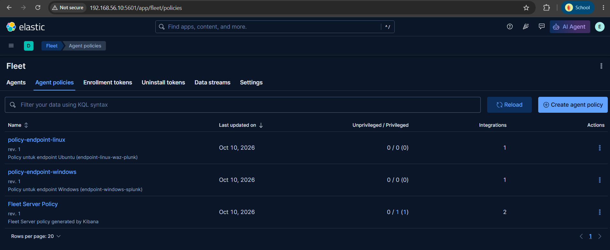

---

## Analisis Akar Masalah

- **Penyebab utama kompleksitas fase ini:** Elastic Stack (berbeda dengan Wazuh yang menyediakan dashboard dan beberapa konfigurasi siap pakai) mengharuskan setiap komponen — Elasticsearch, Kibana, Fleet Server — dikonfigurasi dan dihubungkan manual satu per satu, dengan beberapa langkah keamanan (TLS, encryption key, enrollment token) yang wajib diselesaikan sebelum stack benar-benar berfungsi.
- **Faktor pendukung:** Instalasi manual (bukan *unattended*) dipilih secara sengaja untuk tujuan pembelajaran, sehingga setiap error (misalnya *encryption key* yang hilang) justru menjadi bagian penting dari proses belajar, bukan sekadar hambatan.

---

## Pelajaran yang Didapat

- Sertifikat TLS Elasticsearch perlu dicek dulu daftar *Subject Alternative Name* (SAN)-nya sebelum berpindah menggunakan IP tertentu untuk koneksi — dibuktikan dengan `openssl x509 -noout -ext subjectAltName`.
- Encryption key Kibana untuk Fleet tidak dibuat otomatis saat *enrollment* — ini jebakan umum yang baru terlihat setelah mencoba membuka Fleet.
- Memisahkan agent policy per jenis OS (Windows vs Linux) sejak awal memudahkan pengelolaan integrasi yang berbeda kebutuhan log-nya di fase berikutnya.

---

[← Kembali ke README](README.md) | [Fase Berikutnya: Agent Linux & Windows →](02-agent-linux-dan-windows.md)
