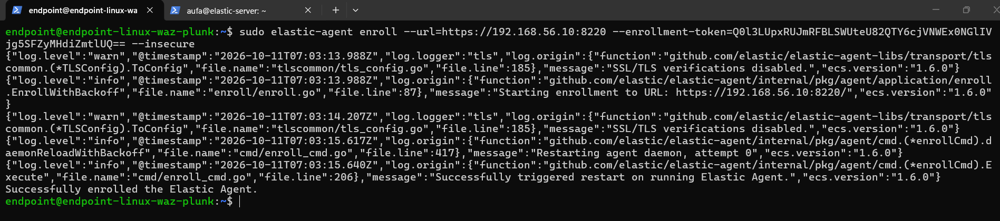
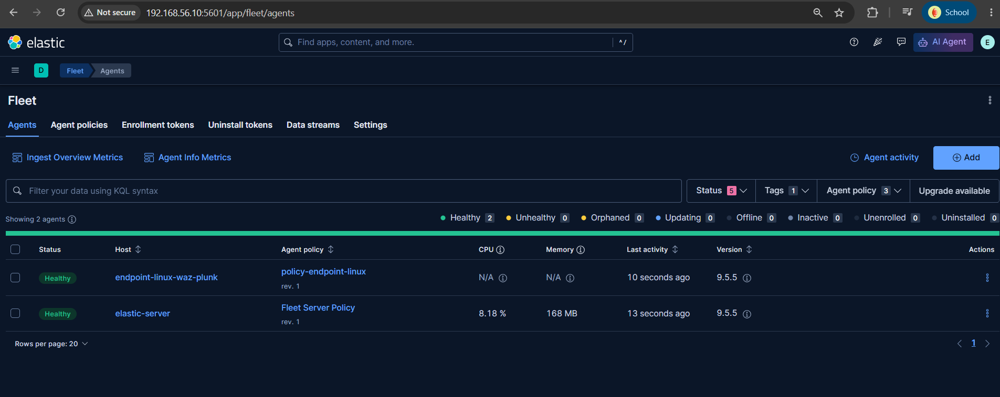
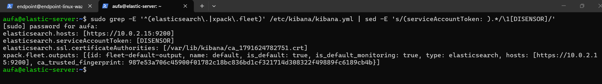
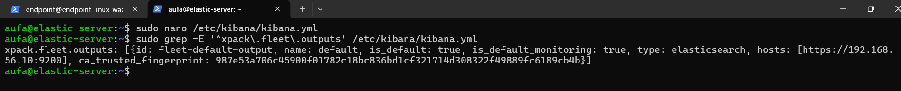
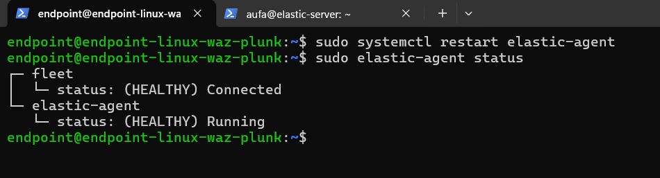
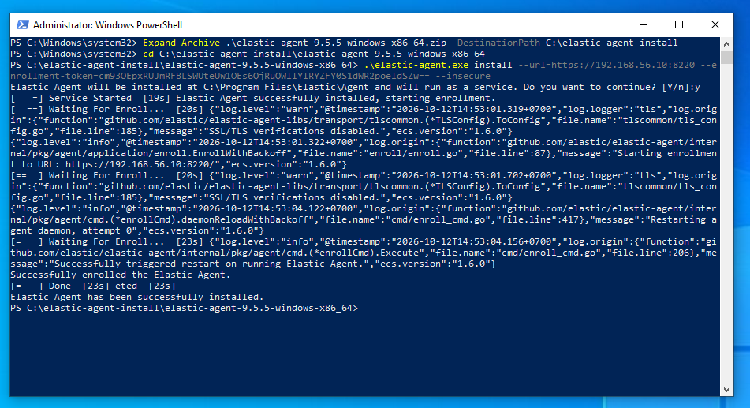
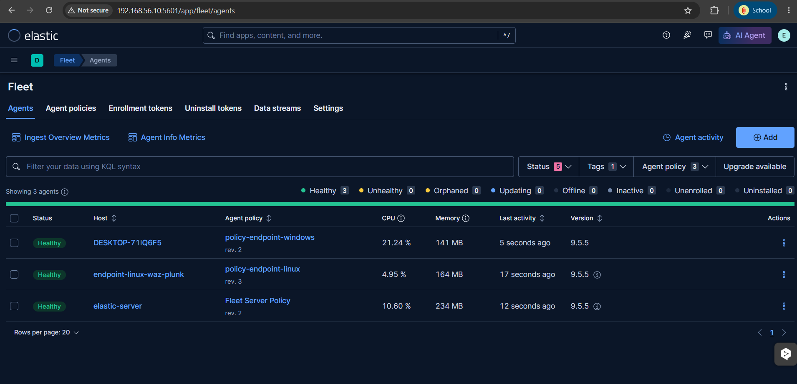
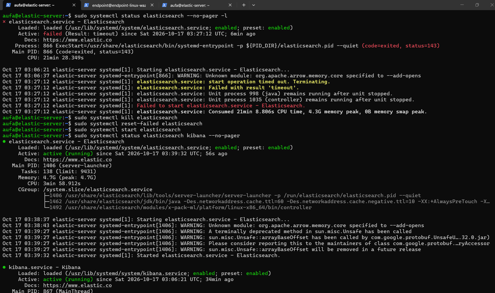
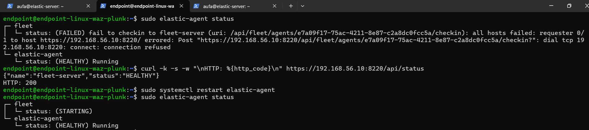

[← Fase Sebelumnya](01-setup-dan-instalasi.md) | [README](README.md) | [Fase Berikutnya: Deteksi Linux →](03-detection-linux.md)

---

# Fase 2 — Pemasangan Elastic Agent & Troubleshooting Infrastruktur

**Platform:** Home Lab (VirtualBox)
**Kategori:** Infrastructure / Agent Deployment
**Tools:** Elastic Agent 9.5.5, systemd, PowerShell

---

## Ringkasan Eksekutif

Fase ini memasang Elastic Agent di dua endpoint (`endpoint-linux-waz-plunk` dan `DESKTOP-71IQ6F5`/Windows) agar log autentikasi dan sistem mereka dikirim ke `elastic-server`. Proses ini menemukan satu insiden konfigurasi signifikan — output Fleet yang secara default tersimpan mengarah ke IP NAT (bukan IP Host-only) — yang membuat endpoint berstatus `DEGRADED` meski terlihat "terhubung" ke Fleet. Insiden ini diselesaikan lewat investigasi berlapis dari gejala di endpoint hingga ke root cause di konfigurasi Kibana. Fase ini juga mendokumentasikan pola kegagalan berulang ("status basi") yang muncul setiap kali VM lab dinyalakan ulang setelah mati beberapa hari.

---

## Indikator Konfigurasi Bermasalah (Infrastructure IOC)

| Tipe | Nilai | Keterangan |
|---|---|---|
| IP salah (root cause) | `10.0.2.15:9200` | IP NAT yang tersimpan sebagai output Fleet default, seharusnya `192.168.56.10:9200` |
| Lokasi konfigurasi bermasalah | `/etc/kibana/kibana.yml` → `xpack.fleet.outputs[].hosts` | Field ini terkunci di UI Kibana karena didefinisikan di file config |
| Error pattern | `dial tcp 10.0.2.15:9200: connect: connection refused` | Muncul di semua komponen agent endpoint saat `elastic-agent status` |
| Agent ID lama (sebelum fix) | `21331674-d591-42cd-8161-5905f08baf65` | Di-unenroll setelah fix, digantikan agent baru |
| Agent ID baru (setelah fix) | `e7a09f17-75ac-4211-8e87-c2a8dc0fcc5a` | Agent aktif endpoint Linux saat ini |

---

## Alur Investigasi

### Fase 2.1: Pemasangan Agent Endpoint Linux

- **Masalah:** Endpoint Linux perlu mengirim log `system.auth` dan `system.syslog` ke Elastic Stack.
- **Investigasi:** Agent di-download, di-install (`dpkg -i`), lalu di-enroll ke Fleet Server menggunakan `--insecure` (karena sertifikat Fleet Server self-signed dan belum dipercaya oleh endpoint).
- **Temuan:** Percobaan *enroll* pertama tanpa `--insecure` gagal dengan error `x509: certificate signed by unknown authority`. Setelah ditambahkan flag tersebut, *enroll* berhasil.
- **Kesimpulan:** Agent terdaftar di Fleet (status Healthy), namun **data belum tentu benar-benar masuk** — ini baru terbukti valid setelah dicek langsung di Discover pada fase berikutnya.

```bash
curl -L -O https://artifacts.elastic.co/downloads/beats/elastic-agent/elastic-agent-9.5.5-amd64.deb
sudo dpkg -i elastic-agent-9.5.5-amd64.deb
sudo systemctl enable --now elastic-agent

sudo elastic-agent enroll \
  --url=https://192.168.56.10:8220 \
  --enrollment-token=<REDACTED> \
  --insecure
```




---

### Fase 2.2: Insiden — Output Fleet Salah Arah ke IP NAT

- **Masalah:** Meski status Fleet menunjukkan "Connected", agent endpoint Linux terus `DEGRADED` dengan error koneksi ke Elasticsearch pada seluruh komponennya (filestream, metrics, log).
- **Investigasi:**
  1. Query `agent.name : "endpoint-linux-waz-plunk"` di Discover menghasilkan **nol dokumen** — membuktikan tidak ada data yang benar-benar masuk, meski status Fleet terlihat sehat.
  2. Pengecekan `sudo elastic-agent status` di endpoint menunjukkan pesan error berulang: `dial tcp 10.0.2.15:9200: connect: connection refused`.
  3. Ditelusuri ke `kibana.yml`, ditemukan baris `xpack.fleet.outputs` masih berisi `hosts: [https://10.0.2.15:9200]` — alamat ini valid untuk Fleet Server sendiri (satu mesin dengan Elasticsearch) tetapi **tidak bisa dijangkau endpoint lain**, karena setiap VM NAT mendapat IP yang sama dan saling terisolasi.
- **Temuan:** Field ini tidak bisa diedit langsung dari UI Fleet Settings (terkunci) karena nilainya didefinisikan di file konfigurasi.
- **Kesimpulan:** Perbaikan dilakukan dengan mengubah `hosts` di blok `xpack.fleet.outputs` menjadi `https://192.168.56.10:9200` (IP Host-only), diikuti restart Kibana, menaikkan revisi agent policy (agar perubahan terdorong ke agent), lalu restart agent di endpoint.

```bash
# Cek sertifikat Elasticsearch mencakup IP Host-only sebelum pindah alamat
echo | openssl s_client -connect 192.168.56.10:9200 2>/dev/null | \
  openssl x509 -noout -ext subjectAltName

# Edit kibana.yml: ganti hosts di xpack.fleet.outputs ke IP Host-only
sudo systemctl restart kibana
# Naikkan revisi policy (edit Description sedikit → Save)
sudo systemctl restart elastic-agent
```





---

### Fase 2.3: Pemasangan Agent Endpoint Windows

- **Masalah:** Endpoint Windows (`DESKTOP-71IQ6F5`) perlu mengirim log `system.security`, `system.system`, `system.application`.
- **Investigasi:** Instalasi via PowerShell (`Invoke-WebRequest`, `Expand-Archive`, `.\elastic-agent.exe install`) dengan flag `--insecure` yang sama.
- **Temuan:** Karena perbaikan output Fleet (Fase 2.2) sudah diterapkan **sebelum** instalasi Windows, agent ini langsung mendapatkan konfigurasi output yang benar sejak awal — tidak mengalami masalah `DEGRADED` seperti pada endpoint Linux.
- **Kesimpulan:** Instalasi berhasil tanpa troubleshooting tambahan, status langsung **Healthy** dengan data terkonfirmasi masuk ("Incoming data confirmed").

```powershell
$ProgressPreference = 'SilentlyContinue'
Invoke-WebRequest -Uri https://artifacts.elastic.co/downloads/beats/elastic-agent/elastic-agent-9.5.5-windows-x86_64.zip `
  -OutFile elastic-agent-9.5.5-windows-x86_64.zip
Expand-Archive .\elastic-agent-9.5.5-windows-x86_64.zip -DestinationPath C:\elastic-agent-install
cd C:\elastic-agent-install\elastic-agent-9.5.5-windows-x86_64

.\elastic-agent.exe install `
  --url=https://192.168.56.10:8220 `
  --enrollment-token=<REDACTED> `
  --insecure
```




---

### Fase 2.4: Pola Kegagalan Berulang Setelah VM Mati Lama

- **Masalah:** Setiap kali lab dinyalakan ulang setelah mati beberapa hari, muncul kombinasi masalah berulang: Elasticsearch gagal *start* dengan timeout, dan agent melaporkan status `FAILED`/`DEGRADED` meski jaringan sebenarnya sehat.
- **Investigasi:**
  1. Elasticsearch sempat timeout *start* selama 21+ menit (`Result: timeout`), diselesaikan dengan `systemctl kill` + `reset-failed` + `start` ulang.
  2. Status agent `no route to host` ternyata adalah **status basi** (hasil checkin terakhir sebelum jaringan stabil), dibuktikan dengan `ping`, `nc -zv`, dan `curl` manual yang semuanya berhasil meski `elastic-agent status` masih melaporkan gagal.
- **Temuan:** `elastic-agent status` tidak melakukan tes koneksi baru setiap dipanggil — ia menampilkan hasil checkin terakhir yang tersimpan di memori proses, sehingga bisa menyesatkan diagnosis jika tidak diverifikasi silang.
- **Kesimpulan:** SOP startup harian disusun (lihat [`referensi/sop-dan-troubleshooting.md`](referensi/sop-dan-troubleshooting.md)) untuk mencegah diagnosis yang salah arah di sesi-sesi berikutnya — intinya: verifikasi jaringan manual dulu sebelum menyimpulkan ada masalah nyata, baru lakukan restart jika memang terbukti perlu.




---

## Analisis Akar Masalah

- **Penyebab utama (Fase 2.2):** Command *enrollment* Fleet Server awal menggunakan alamat `https://10.0.2.15:9200` (IP NAT) yang valid untuk Fleet Server itu sendiri, namun secara tidak sengaja tersimpan sebagai **output default** yang dibagikan ke seluruh agent lain — bukan hanya dipakai Fleet Server secara lokal.
- **Faktor pendukung:** Field output Fleet yang terkunci di UI (karena didefinisikan via file config) membuat perbaikan tidak bisa dilakukan lewat antarmuka web, melainkan harus langsung mengedit `kibana.yml`.

---

## Remediasi & Rekomendasi

**Tindakan yang sudah diambil:**
- Perbaikan `xpack.fleet.outputs` di `kibana.yml`, bump revisi policy, restart agent.
- SOP startup harian didokumentasikan untuk mencegah pola kegagalan berulang.

**Rekomendasi jangka panjang:**
- Untuk lab dengan lebih dari satu Fleet Server/output, pertimbangkan memisahkan command *enrollment* Fleet Server (internal) dari konfigurasi output agent (untuk endpoint luar) sejak awal, agar tidak tertukar seperti pada insiden ini.

---

## Pelajaran yang Didapat

- Status "Healthy"/"Connected" pada dashboard SIEM **tidak selalu membuktikan data benar-benar mengalir** — validasi akhir harus selalu dilakukan di titik penerimaan data (Discover), bukan hanya di status agent.
- Diagnosis jaringan sebaiknya dimulai dari verifikasi manual (`ping`, `nc`, `curl`) sebelum mempercayai status yang ditampilkan tool monitoring, karena status tersebut bisa jadi representasi kondisi lampau, bukan kondisi saat ini.

---

[← Fase Sebelumnya](01-setup-dan-instalasi.md) | [README](README.md) | [Fase Berikutnya: Deteksi Linux →](03-detection-linux.md)
