[← Fase Sebelumnya](02-agent-linux-dan-windows.md) | [README](README.md) | [Fase Berikutnya: Deteksi Windows →](04-detection-windows.md)

---

# Fase 3 — Simulasi Serangan & Deteksi Brute Force SSH (Endpoint Linux)

**Platform:** Home Lab (VirtualBox)
**Tingkat Kesulitan:** Menengah
**Kategori:** Intrusion Detection — Credential Access
**Tools:** Kali Linux, Nmap, Hydra, Kibana Discover, Kibana Security Rules, Kibana Lens

---

## Ringkasan Eksekutif

Endpoint Linux (`endpoint-linux-waz-plunk`, IP `192.168.56.106`) disimulasikan sebagai target serangan *brute force* SSH dari mesin Kali Linux (`192.168.56.102`). Investigasi manual di Kibana Discover sempat menemui jalan buntu karena field hasil parsing (`event.action`, `event.outcome`) ternyata tidak reliabel untuk membedakan login berhasil dan gagal — solusi ditemukan dengan menelusuri log mentah `/var/log/auth.log` langsung di endpoint. Berdasarkan temuan ini, sebuah Detection Rule custom dibuat dan terbukti berhasil memicu 39 alert otomatis saat serangan diulang, dilengkapi dashboard visualisasi tren dan sumber serangan.

---

## Indikator Kompromi (IOC)

| Tipe IOC | Nilai | Keterangan |
|---|---|---|
| Alamat IP Penyerang | `192.168.56.102` | Mesin Kali Linux, sumber tunggal seluruh percobaan brute force (100% pada breakdown dashboard) |
| Endpoint Korban | `192.168.56.106` | `endpoint-linux-waz-plunk`, port 22/SSH |
| Port Target | `22/tcp` (SSH) | Satu-satunya port terbuka hasil `nmap -sV` |
| Versi Layanan | `OpenSSH 9.6p1 Ubuntu 3ubuntu13.18` | Hasil service detection nmap |
| Username yang Dicoba | `root`, `admin`, `endpoint`, `test` | Wordlist custom (`users.txt`) |
| Username Valid (berhasil) | `endpoint` | Username asli akun SSH endpoint |
| Total Percobaan per Sesi | 20 (4 user × 5 password) | Per eksekusi Hydra |
| Total Kejadian Gagal (akumulasi 3 hari) | ~327 | Gabungan beberapa sesi Hydra, terlihat di dashboard |

---

## Alur Investigasi

### Fase 3.1: Reconnaissance

- **Masalah:** Perlu diketahui permukaan serangan (*attack surface*) endpoint Linux sebelum melakukan brute force.
- **Investigasi:** Port scan dengan deteksi versi layanan dari Kali.
- **Temuan:** Hanya port 22 (SSH) yang terbuka, menjalankan OpenSSH 9.6p1.
- **Kesimpulan:** SSH menjadi satu-satunya vektor serangan realistis pada endpoint ini.

```bash
nmap -sV 192.168.56.106
```

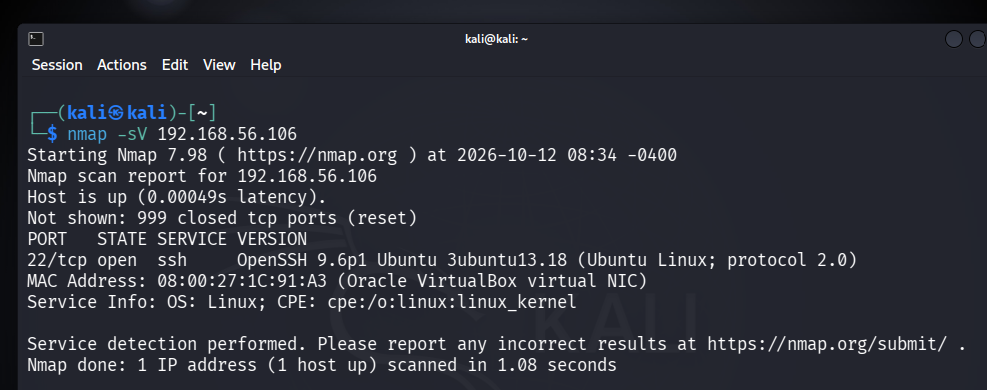

Scan ini sendiri meninggalkan jejak di `system.auth` — dikonfirmasi lewat query KQL berikut, dengan rentang waktu kejadian yang persis cocok dengan waktu scan dijalankan:

```
agent.name : "endpoint-linux-waz-plunk" and data_stream.dataset : "system.auth"
```

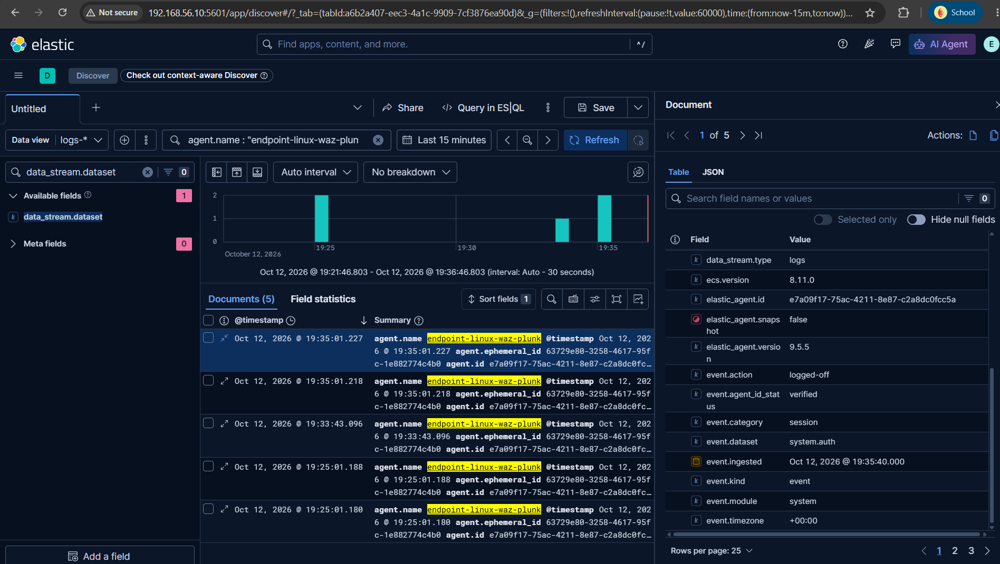

---

### Fase 3.2: Simulasi Brute Force SSH

- **Masalah:** Membuktikan serangan credential-guessing dapat tercatat dan terdeteksi oleh pipeline log yang sudah dibangun.
- **Investigasi:** Dibuat wordlist custom (bukan `rockyou.txt`) agar hasil terkontrol dan mudah divalidasi, lalu dijalankan Hydra dengan parameter task paralel diturunkan dari default (16) ke 4, karena percobaan awal gagal total akibat rate-limit `MaxStartups` pada SSH daemon.
- **Temuan:** Hydra berhasil menemukan kombinasi valid: `login: endpoint password: <redacted>`.
- **Kesimpulan:** Satu sesi serangan menghasilkan 20 percobaan autentikasi (19 gagal, 1 berhasil).

```bash
# users.txt dan passwords.txt dibuat manual via heredoc, bukan wordlist publik
hydra -L users.txt -P passwords.txt -t 4 ssh://192.168.56.106
```

```
[22][ssh] host: 192.168.56.106   login: endpoint   password: [REDACTED]
1 of 1 target successfully completed, 1 valid password found
```

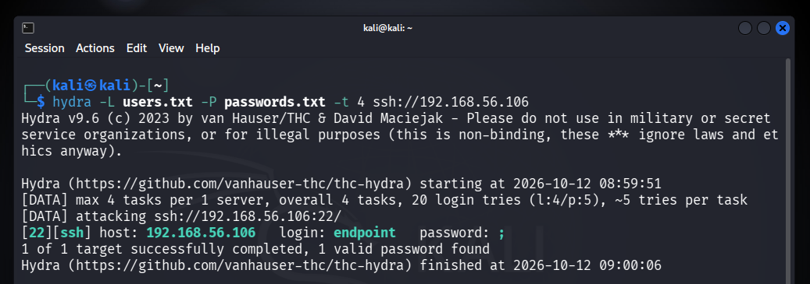
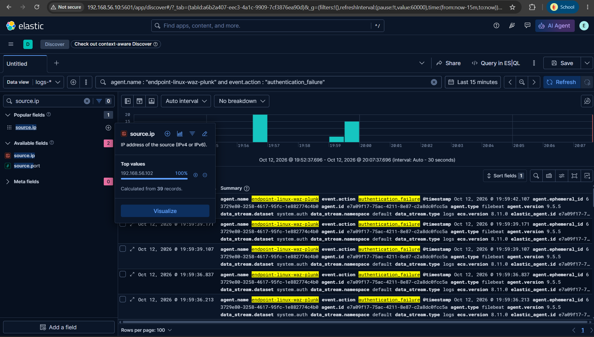

---

### Fase 3.3: Investigasi Field — Jalan Buntu dan Solusinya

Ini adalah bagian paling bernilai secara metodologis dari fase ini: proses menemukan field yang *benar-benar* dapat dipercaya di tengah field hasil parsing yang menyesatkan.

- **Masalah:** Query `event.action : "authentication_success"` menghasilkan **nol dokumen**, padahal Hydra mengonfirmasi satu login berhasil.
- **Investigasi (langkah 1):** Ditemukan field alternatif `event.action: "ssh_login"` yang diduga sebagai penanda sukses.
- **Temuan (langkah 1):** Dugaan ini salah — field `event.outcome` pada dokumen `ssh_login` **sama-sama bernilai `"failure"`**, identik dengan dokumen `authentication_failure`. Field hasil parsing ini tidak bisa diandalkan untuk membedakan sukses/gagal.
- **Investigasi (langkah 2):** Alih-alih menebak field lain, dilakukan verifikasi langsung ke sumber log mentah di endpoint.
- **Temuan (langkah 2):** `grep -a "Accepted password" /var/log/auth.log` mengonfirmasi baris asli OpenSSH: `Accepted password for endpoint from 192.168.56.102 port 59080 ssh2`. Kata kunci ini kemudian dicari di Kibana via *full-text search* tanpa menyebut nama field, dan ditemukan tersimpan di field **`message`** — field yang menyimpan baris log mentah apa adanya.
- **Kesimpulan:** Query final yang presisi dan reliabel:

```
message : "Accepted password*"   // login berhasil
message : "Failed password*"      // login gagal
```

```bash
# Log biner terdeteksi oleh grep standar, perlu dipaksa baca sebagai teks dengan -a
sudo grep -a "Accepted password" /var/log/auth.log
```

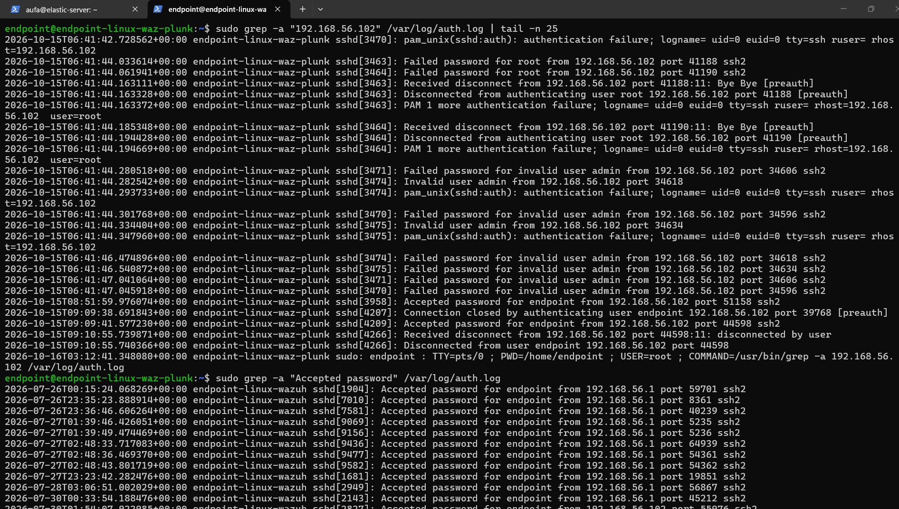
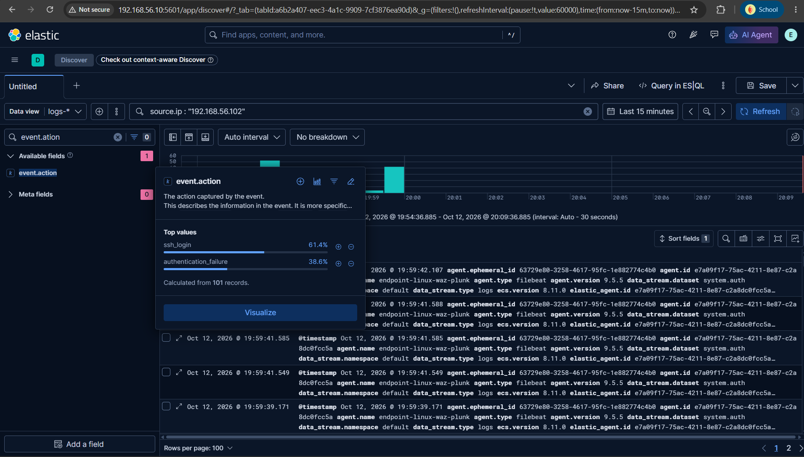
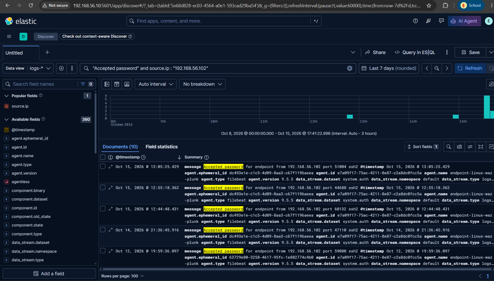

---

### Fase 3.4: Pembuatan Detection Rule

- **Masalah:** Investigasi manual tidak scalable — dibutuhkan mekanisme otomatis yang terus memonitor pola serangan ini.
- **Investigasi:** Dibuat rule bertipe **Custom query**, memakai persis query yang sudah tervalidasi pada fase sebelumnya. Rule preview (rentang "Last 1 day") sempat menunjukkan 181 alert historis sebagai bukti query valid sebelum rule diaktifkan secara permanen.
- **Temuan:** Setelah rule di-*enable* dan serangan Hydra diulang, **39 alert otomatis** muncul di halaman Security → Alerts dalam satu siklus eksekusi (~5 menit), tanpa intervensi manual.
- **Kesimpulan:** Rule berhasil divalidasi end-to-end: serangan → data masuk → rule terjadwal jalan → alert muncul otomatis.

**Konfigurasi Rule:**

| Field | Nilai |
|---|---|
| Nama | Potential SSH Brute Force - Endpoint Linux |
| Tipe | Custom query (KQL) |
| Query | `data_stream.dataset : "system.auth" and message : "Failed password*"` |
| Index pattern | `logs-*` |
| Severity | Medium |
| Risk score | 47 |
| Schedule | Runs every 5 menit, additional look-back 1 menit |
| Tags | `brute-force`, `ssh`, `linux`, `T1110.001` |

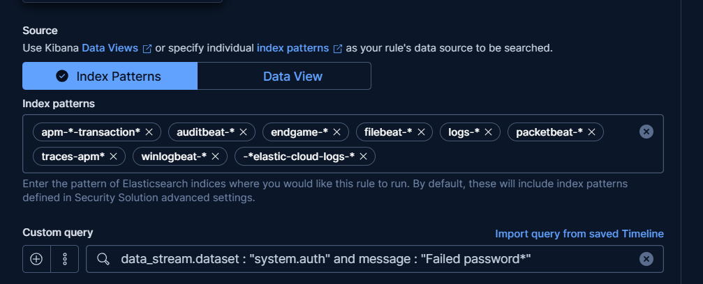
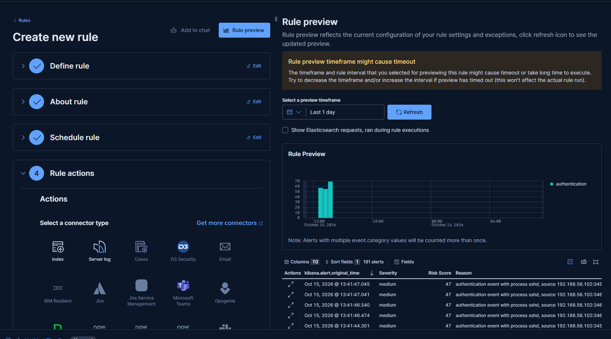
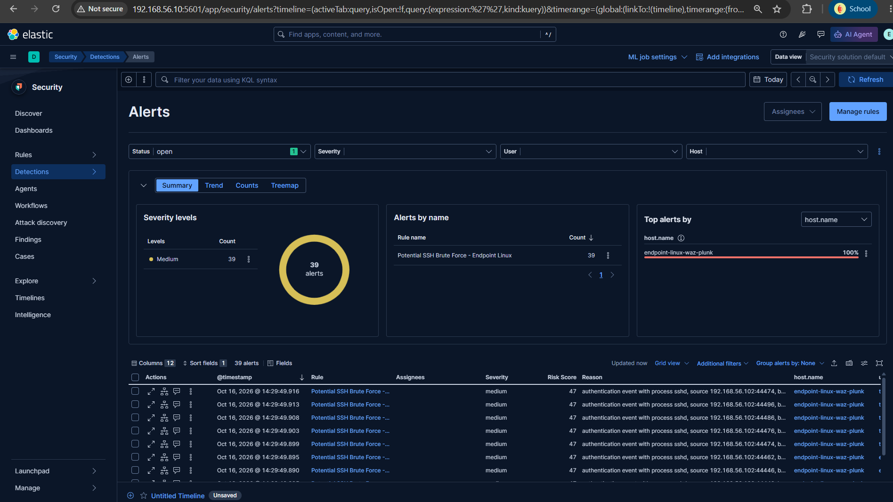

---

### Fase 3.5: Dashboard Visualisasi

- **Masalah:** Berbeda dengan Wazuh yang menyediakan dashboard siap pakai, Kibana mengharuskan visualisasi dirancang manual dari nol.
- **Investigasi:** Dibangun dua panel menggunakan editor Lens: (1) bar chart tren waktu `Failed password` dengan breakdown per `source.ip`, interval histogram diset ke `1m` (perhatian khusus diperlukan di sini — satuan `M` besar berarti bulan, bukan menit, sempat menyebabkan chart salah total sebelum dikoreksi); (2) pie chart top sumber IP penyerang.
- **Temuan:** Breakdown menunjukkan **100% serangan berasal dari satu IP tunggal** (`192.168.56.102`), dengan pola lonjakan tajam yang jelas (baseline datar lalu melonjak ~38 kejadian dalam hitungan detik) — visual klasik brute force.
- **Kesimpulan:** Dashboard **"SSH Brute Force - Endpoint Linux"** tersimpan permanen (terkonfirmasi tetap ada setelah restart server berhari-hari kemudian).

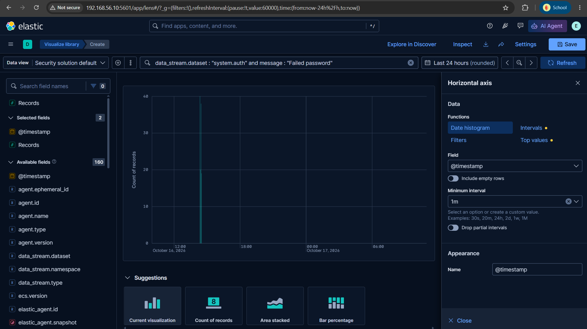
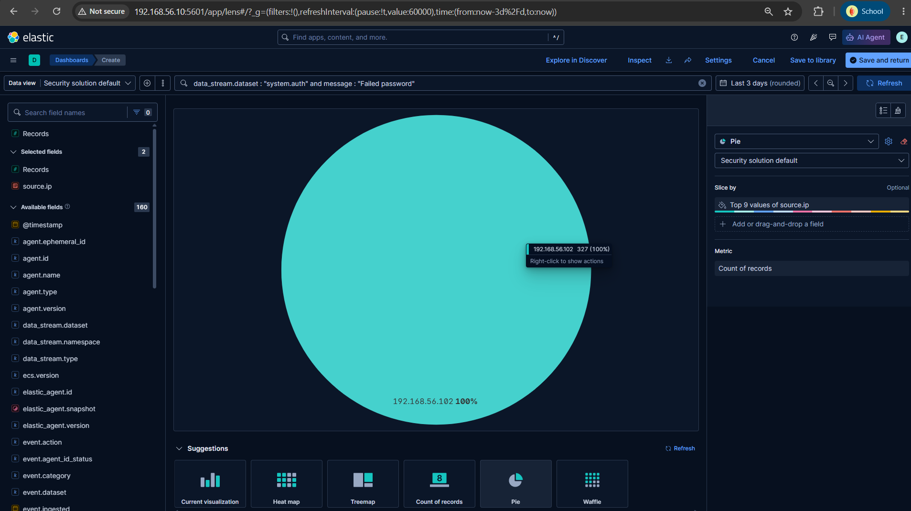
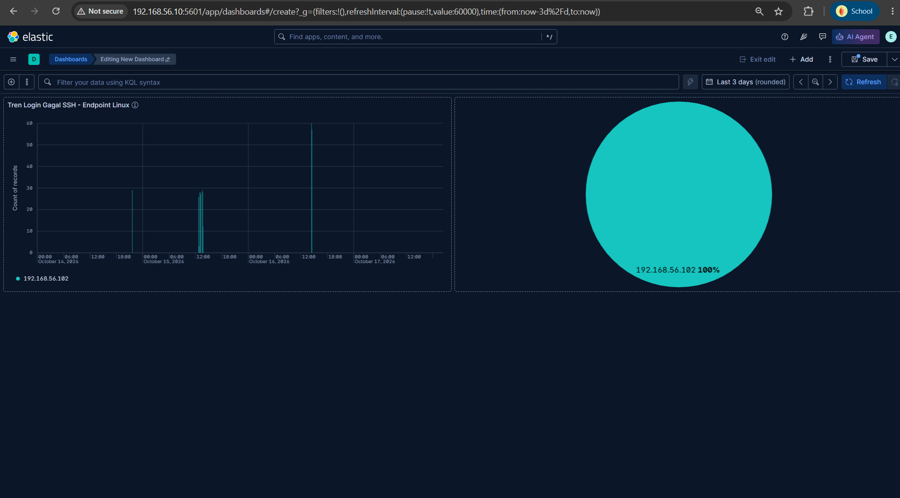

---

## Analisis Akar Masalah

- **Penyebab utama:** Endpoint hanya memiliki SSH dengan autentikasi password (bukan key-based) sebagai satu-satunya layanan terbuka, dan tidak ada mekanisme pembatas percobaan login (seperti `fail2ban`) yang aktif pada konfigurasi lab ini.
- **Faktor pendukung:** Password yang digunakan sebagai "password asli" dalam simulasi ini sengaja dibuat lemah untuk tujuan pengujian deteksi, bukan representasi kebijakan password produksi.

---

## Penilaian Dampak

- **Sistem terdampak:** `endpoint-linux-waz-plunk` (simulasi lab, bukan sistem produksi).
- **Data yang mungkin terekspos:** Akses shell penuh sebagai user `endpoint` jika serangan ini nyata dan tidak terdeteksi.
- **Jangkauan lateral movement:** Tidak diuji pada fase ini — scope dibatasi pada deteksi akses awal (*initial access*).

---

## Remediasi & Rekomendasi

**Tindakan segera (jika ini insiden nyata):**
- Isolasi endpoint dari jaringan, reset kredensial user `endpoint`, cek riwayat login untuk indikasi akses lanjutan pasca-kompromi.

**Jangka pendek:**
- Terapkan `fail2ban` atau mekanisme rate-limiting SSH native untuk membatasi percobaan login berulang.
- Pertimbangkan migrasi ke autentikasi SSH key-based, menonaktifkan autentikasi password.

**Jangka panjang:**
- Upgrade rule dari tipe Custom query ke tipe **Threshold** untuk perhitungan ambang batas yang lebih presisi secara otomatis (belum dilakukan di project ini, bersifat opsional).
- Tambahkan notifikasi (Slack/email) saat alert terpicu — sengaja dilewati di project ini karena di luar scope pembelajaran inti.

---

## Pelajaran yang Didapat

- Field hasil parsing SIEM (`event.action`, `event.outcome`) **tidak selalu bisa dipercaya langsung** — saat investigasi mentok, menelusuri log mentah di sumbernya (`message` field, atau file log asli via `grep`) adalah langkah paling dasar dan reliabel.
- Status dashboard yang terlihat "baik-baik saja" (seperti notifikasi "Incoming data confirmed" di Fase 2) tidak menggantikan validasi langsung di titik data — pola ini konsisten muncul beberapa kali di sepanjang project dan menjadi prinsip kerja utama: *selalu verifikasi di sumber data, bukan di indikator status*.
- Satuan waktu di konfigurasi Elastic bersifat *case-sensitive* (`m` = menit, `M` = bulan) — detail kecil yang berdampak besar pada keakuratan visualisasi.

---

## Playbook: Deteksi Brute Force SSH

**Pemicu:** Alert dari rule "Potential SSH Brute Force" terpicu di Security → Alerts.

**Langkah Triase:**
1. Cek `source.ip` pada alert — apakah IP dikenal (misalnya penetration tester internal) atau benar-benar asing.
2. Hitung jumlah `Failed password` dari IP tersebut dalam 5 menit terakhir via Discover — bandingkan dengan baseline normal (biasanya 0–2 kegagalan wajar dari salah ketik manusia).
3. Cari apakah ada entri `Accepted password` dari IP yang sama setelah rentetan kegagalan — ini indikasi serangan **berhasil**, bukan sekadar percobaan.

**Kriteria Eskalasi:**
- Ditemukan entri `Accepted password` menyusul banyak `Failed password` dari IP yang sama → eskalasi segera, anggap kredensial sudah bocor.
- Lebih dari satu `source.ip` berbeda menyerang endpoint yang sama dalam waktu berdekatan → indikasi serangan terkoordinasi/distributed.

**Tindakan Penahanan:**
- Blokir `source.ip` di firewall endpoint/jaringan.
- Jika login berhasil terkonfirmasi, paksa reset password user terkait dan audit sesi aktif.

**Indikator False Positive:**
- IP dikenal sebagai alat automation/monitoring internal yang memang melakukan health-check via SSH.
- Jumlah kegagalan kecil (1–3 kali) dari IP yang sama dengan jeda waktu wajar — kemungkinan user biasa salah ketik password.

---

[← Fase Sebelumnya](02-agent-linux-dan-windows.md) | [README](README.md) | [Fase Berikutnya: Deteksi Windows →](04-detection-windows.md)
