[← Fase Sebelumnya](03-detection-linux.md) | [README](README.md) | [Fase Berikutnya: Hasil & Kesimpulan →](05-hasil-dan-kesimpulan.md)

---

# Fase 4 — Simulasi Serangan & Deteksi Brute Force RDP (Endpoint Windows)

**Platform:** Home Lab (VirtualBox)
**Tingkat Kesulitan:** Menengah–Sulit (lebih kompleks dari fase Linux karena troubleshooting konektivitas RDP)
**Kategori:** Intrusion Detection — Credential Access
**Tools:** Kali Linux, Nmap, Crowbar, rdesktop, xfreerdp, Hydra, Kibana Discover, Kibana Security Rules (Threshold), Kibana Lens

---

## Ringkasan Eksekutif

Sebelum investigasi RDP dimulai, endpoint Windows (`DESKTOP-71IQ6F5`, IP `192.168.56.109`) ditemukan dalam status `Offline` di Fleet setelah lama tidak dinyalakan — berbeda dari Linux yang auto-start via systemd, service Elastic Agent di Windows perlu diaktifkan manual. Setelah itu baru disimulasikan sebagai target brute force RDP dari Kali Linux. Fase ini diawali dengan RDP yang belum aktif di sisi Windows serta kegagalan tool `crowbar` yang berulang, baru berhasil setelah beralih ke Hydra dengan modul RDP. Investigasi lanjutan di Kibana mengonfirmasi Event Code 4625 (logon gagal) dan 4624 (logon berhasil, LogonType 10/RemoteInteractive untuk RDP) sebagai field paling reliabel. Detection Rule kali ini dibangun dengan tipe **Threshold** (berbeda dari tipe Custom query pada fase Linux) dan dilengkapi pemetaan MITRE ATT&CK eksplisit saat pembuatan rule.

---

## Indikator Kompromi (IOC)

| Tipe IOC | Nilai | Keterangan |
|---|---|---|
| Alamat IP Penyerang | `192.168.56.102` | Mesin Kali Linux, dikonfirmasi lewat field `source.ip` (86% dari total percobaan gagal) |
| Endpoint Korban | `192.168.56.109` | `DESKTOP-71IQ6F5`, port 3389/RDP |
| Port Target | `3389/tcp` (RDP) | Hasil `nmap` menunjukkan port terbuka, service `ms-wbt-server` |
| Username yang Diserang | `aufa` | Ditambahkan ke `users.txt` sebelum serangan berhasil |
| Tool yang Berhasil | Hydra (modul `rdp`, backend `freerdp`) | Crowbar (backend `rdesktop`) dan `rdesktop` manual gagal karena tidak mendukung NLA/CredSSP |
| Event Code Logon Gagal | `4625` | Windows Security Log, LogonType 3 (Network) |
| Event Code Logon Berhasil | `4624`, LogonType `10` | LogonType 10 = RemoteInteractive (RDP) |
| Jumlah Alert Threshold | 26 kejadian dari `192.168.56.102` dalam satu window 5 menit | Terkonfirmasi di detail alert rule (`kibana.alert.threshold_result.count`) |

---

## Alur Investigasi

### Fase 4.1: Elastic Agent Windows Offline Setelah VM Lama Tidak Aktif

- **Masalah:** Di awal sesi, Fleet menunjukkan `DESKTOP-71IQ6F5` berstatus `Offline` dengan last activity "last week", meski VM sudah dinyalakan. `elastic-server` sendiri juga sempat `Unhealthy` sesaat (ternyata self-healed dalam 1 menit tanpa intervensi — race condition autentikasi saat boot, bukan masalah nyata).
- **Investigasi:** Diagnosis dilakukan berurutan dari luar ke dalam, bukan langsung restart: `ping` ke `elastic-server` dari Windows (sukses, 0% loss), lalu `Test-NetConnection` ke port Fleet Server 8220 (sukses, `TcpTestSucceeded: True`) — jaringan dasar dan port terbukti sehat. Baru kemudian dicek `Get-Service "Elastic Agent"` → hasilnya `Stopped`. Percobaan `Start-Service` pertama gagal dengan error `Cannot open Elastic Agent service` karena PowerShell tidak dijalankan sebagai Administrator.
- **Temuan:** Setelah dicek, `StartType` service ini ternyata **sudah** `Automatic` — bukan `Manual` seperti dugaan awal. Artinya kegagalan start ini bukan soal konfigurasi startup type yang salah, melainkan kemungkinan service gagal start sekali saat boot (dugaan: dependency/network adapter belum siap) dan Windows tidak melakukan retry otomatis. Root cause pastinya tidak terkonfirmasi 100%.
- **Kesimpulan:** Setelah `Start-Service` dijalankan dari PowerShell **as Administrator**, ketiga agent (Linux, Windows, elastic-server) kembali `Healthy`. Langkah ini ditambahkan sebagai rutinitas baru di SOP startup harian (Langkah 7) — berbeda dari Linux yang auto-start via systemd, Elastic Agent Windows perlu dicek dan di-start manual setiap kali VM dinyalakan setelah lama mati.

```powershell
ping 192.168.56.10
Test-NetConnection -ComputerName 192.168.56.10 -Port 8220
Get-Service -Name "Elastic Agent"

# Start-Service gagal tanpa privilege admin:
# Error: Cannot open Elastic Agent service on computer '.'.
# Harus dijalankan dari PowerShell "Run as Administrator":
Start-Service -Name "Elastic Agent"
Get-Service -Name "Elastic Agent" | Select-Object Name, StartType
```

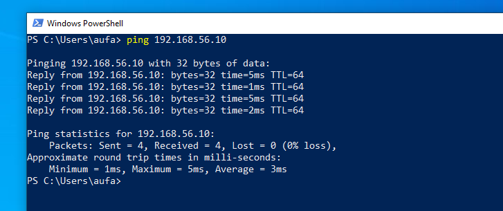
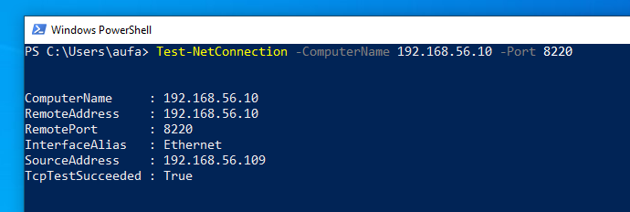
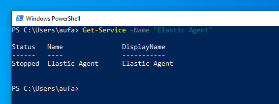
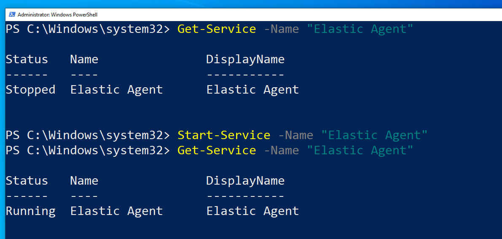
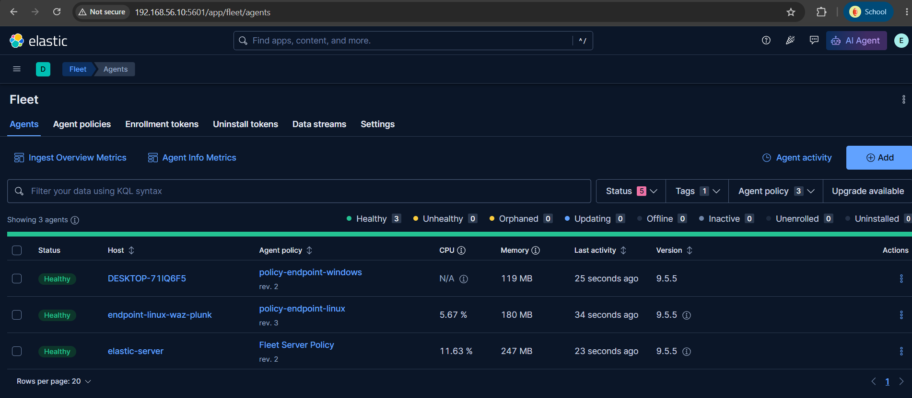
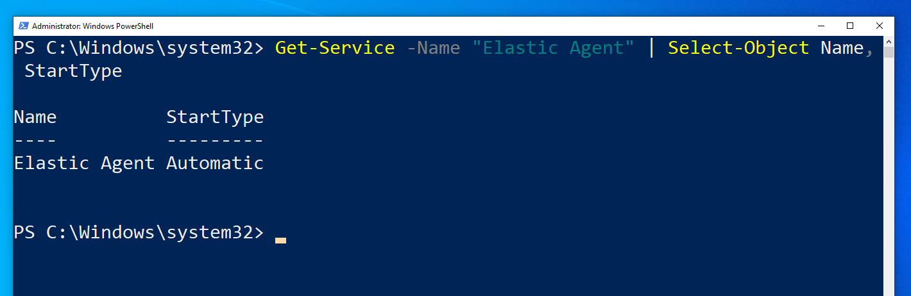

---

### Fase 4.2: Prasyarat — Mengaktifkan RDP di Endpoint Windows

- **Masalah:** Remote Desktop secara default tidak aktif di instalasi Windows ini (`Get-Service TermService` → `Stopped`).
- **Investigasi:** RDP diaktifkan melalui kombinasi tiga lapisan: registry (`fDenyTSConnections`), Windows Firewall rule grup "Remote Desktop", dan service `TermService` itu sendiri.
- **Temuan:** Ketiga lapisan ini saling independen — mengaktifkan registry saja atau firewall saja tidak cukup, ketiganya harus benar bersamaan sebelum RDP bisa diakses dari jaringan.
- **Kesimpulan:** RDP berhasil diaktifkan dan dapat diakses dari jaringan Host-only setelah ketiga lapisan dikonfirmasi aktif.

```powershell
Get-Service TermService

Set-ItemProperty -Path 'HKLM:\System\CurrentControlSet\Control\Terminal Server' `
  -Name "fDenyTSConnections" -Value 0
Enable-NetFirewallRule -DisplayGroup "Remote Desktop"
Start-Service -Name TermService
Get-Service -Name TermService
```

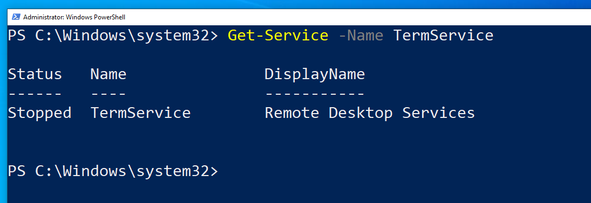
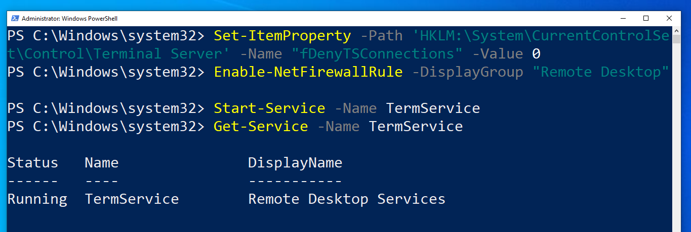

---

### Fase 4.3: Reconnaissance & Percobaan Awal yang Gagal

- **Masalah:** Memastikan RDP benar-benar dapat diakses dari sisi penyerang sebelum brute force dimulai.
- **Investigasi:** Port scan mengonfirmasi 3389 terbuka. Percobaan pertama menggunakan **Crowbar** gagal berulang kali — tanpa hasil sama sekali dalam waktu kurang dari 1 detik (indikasi tidak benar-benar mencoba koneksi ke jaringan), baik dijalankan dengan maupun tanpa `sudo`, serta error *invalid CIDR* pada format target tanpa `/32`. Percobaan manual dengan `rdesktop` juga gagal, pertama dengan kegagalan koneksi TCP murni (`tcp_connect(), unable to connect`). Setelah dicek `Get-NetConnectionProfile`, kedua adapter jaringan Windows ternyata berkategori **Public** (bukan Private) — namun ini **tidak diperbaiki secara eksplisit**; ping yang tadinya gagal pulih sendiri (kemungkinan dipicu oleh proses login/unlock akun `aufa` di VM), dan percobaan `rdesktop` berikutnya berhasil terkoneksi sampai tahap sertifikat, tapi gagal lagi dengan error terkait **NLA/CredSSP** (`Failed to initialize NLA... CredSSP required by server`).
- **Temuan:** Kegagalan Crowbar dan `rdesktop` ternyata bukan soal jaringan/firewall — root cause sebenarnya adalah **ketidakcocokan tool**: keduanya menggunakan backend `rdesktop`, tool lama yang tidak mendukung Network Level Authentication (NLA/CredSSP) yang diwajibkan RDP modern Windows. Dicek dengan `which rdesktop` — tool-nya memang terpasang, bukan soal "tidak ada", tapi soal tidak kompatibel dengan protokol keamanan target.
- **Kesimpulan:** Setelah dikonfirmasi `hydra` mendukung modul `rdp` (`hydra -h | grep -i rdp`) dan menggunakan backend `freerdp` (library modern yang mendukung NLA), serangan dialihkan sepenuhnya ke Hydra.

```bash
nmap -p 3389 192.168.56.109
# Crowbar — gagal instan berulang kali (backend rdesktop)
crowbar -b rdp -s 192.168.56.109/32 -U users.txt -C passwords.txt
# rdesktop manual — gagal TCP connect, lalu gagal NLA/CredSSP
rdesktop -u aufa -p '<password>' 192.168.56.109
which rdesktop
```

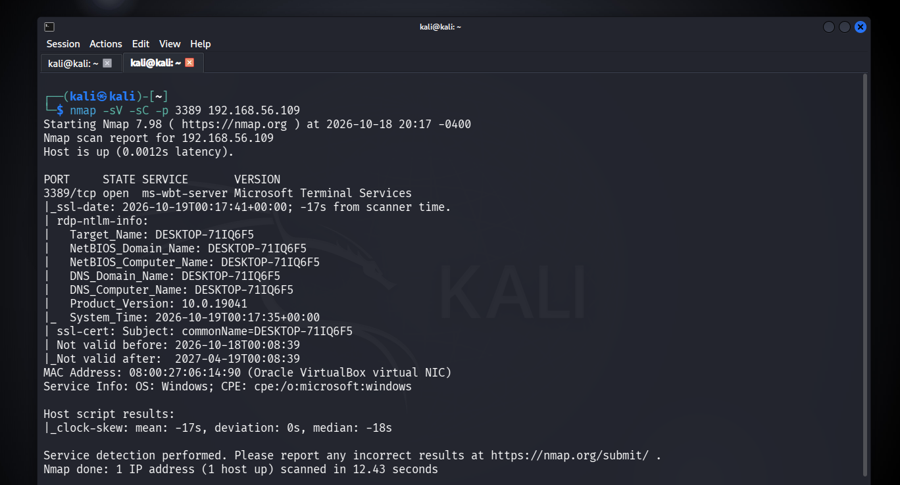
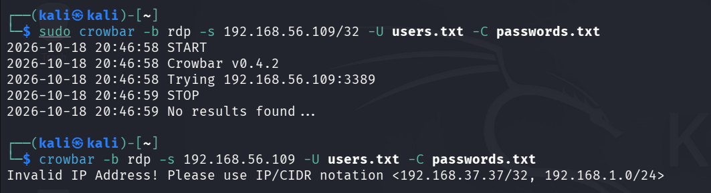
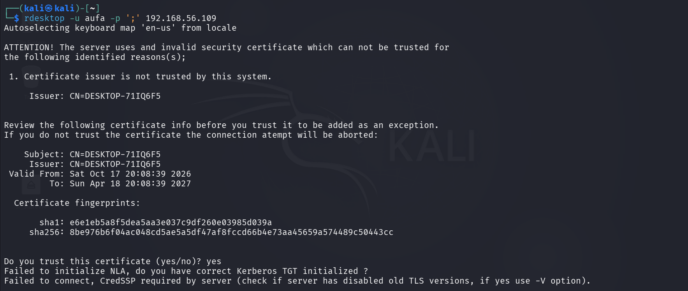

---

### Fase 4.4: Brute Force Berhasil dengan Hydra

- **Masalah:** Membuktikan serangan credential-guessing terhadap RDP dapat berhasil dan tercatat di log Windows.
- **Investigasi:** Username `aufa` ditambahkan ke `users.txt` (sebelumnya berisi `root`, `admin`, `endpoint`, `test`). Hydra dijalankan dengan modul `rdp`, wordlist multi-user, menarget `192.168.56.109`.
- **Temuan:** Hydra mencoba seluruh kombinasi di `users.txt`, beberapa gagal (`freerdp: connection failed to establish` — kemungkinan username tidak valid di sistem), dan akhirnya berhasil menemukan kredensial valid untuk user `aufa`. Beberapa percobaan gagal inilah yang nantinya ikut terhitung di threshold Detection Rule.
- **Kesimpulan:** Serangan RDP berhasil disimulasikan, membuka jalan untuk investigasi deteksi di sisi Windows Event Log.

```bash
hydra -L users.txt -P passwords.txt rdp://192.168.56.109 -t 4
```

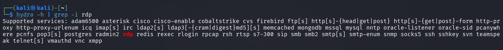
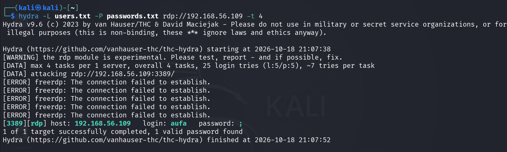

---

### Fase 4.5: Investigasi Field Windows Event Log

- **Masalah:** Berbeda dari Linux (field `message` sebagai sumber kebenaran utama), field Windows Event Log terstruktur berbeda dan perlu divalidasi dari awal — tidak bisa mengasumsikan pola yang sama persis.
- **Investigasi:** Dataset `system.security` dieksplorasi di Discover, lalu difilter khusus Event Code `4625` (logon gagal). Isi `message` mentah diperiksa penuh untuk konfirmasi (`Account Name: aufa`, `Source Network Address: 192.168.56.102`, `Logon Type: 3`), dilanjutkan membandingkan dengan Event Code `4624` (logon berhasil).
- **Temuan:** `LogonType: 10` pada Event 4624 mengonfirmasi jenis logon sebagai **RemoteInteractive** (RDP) — berbeda dari `LogonType: 3` (Network) pada percobaan gagal, dan berbeda lagi dari `LogonType: 2`/`5` yang muncul dari aktivitas normal Windows (login lokal manual, service internal). Field `source.ip` terbukti **reliable** sebagai field terstruktur (beda dari kasus Linux, di mana field hasil parsing seperti `event.action` justru tidak bisa diandalkan). Nama field raw `LogonType` tersedia di dua bentuk: `winlog.event_data.LogonType` (angka, mis. `10`) dan `winlog.logon.type` (label teks, mis. `RemoteInteractive`).
- **Kesimpulan:** Query dasar yang tervalidasi untuk deteksi RDP brute force di Windows:

```
data_stream.dataset : "system.security" and event.code : "4625"
// Semua percobaan gagal — dipakai sebagai query utama Detection Rule

data_stream.dataset : "system.security" and event.code : "4624" and winlog.logon.type : "RemoteInteractive"
// Login sukses via RDP secara spesifik (untuk korelasi manual, bukan rule otomatis)
```

Untuk konfirmasi tambahan menggunakan **xfreerdp** (bukan sekadar Hydra) sebagai bukti independen bahwa kredensial yang ditemukan benar-benar valid secara fungsional dan bisa dipakai login penuh:

```bash
xfreerdp /v:192.168.56.109 /u:aufa /p:'<password>' /cert:ignore
```

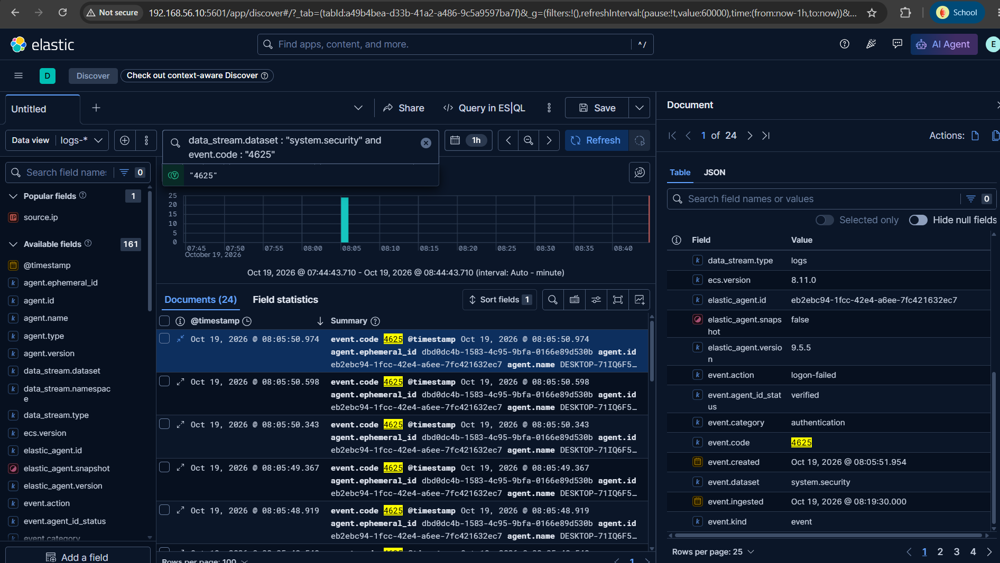
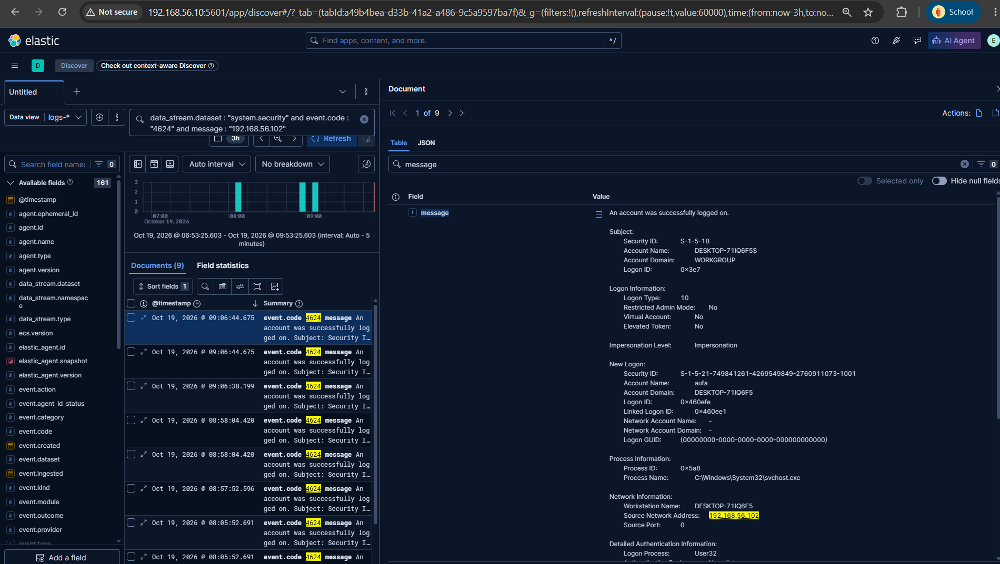
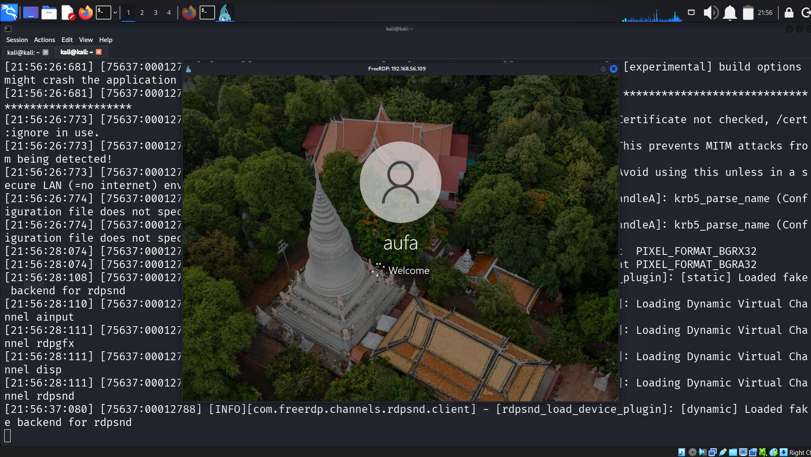

---

### Fase 4.6: Pembuatan Detection Rule — Tipe Threshold

- **Masalah:** Sama seperti di Linux, dibutuhkan mekanisme deteksi otomatis — kali ini dipilih pendekatan berbeda (Threshold) untuk eksplorasi kapabilitas Kibana lebih lanjut sekaligus perbandingan metodologi.
- **Investigasi:** Rule dibangun dengan **tipe Threshold** (bukan Custom query seperti di Linux), dengan query `event.code: "4625"`, **Group by** `source.ip`, **Threshold** `>= 5` kejadian per window 5 menit. Pemetaan **MITRE ATT&CK** diisi eksplisit saat pembuatan rule: Tactic **Credential Access (TA0006)** → Technique **Brute Force (T1110)** → Sub-technique **Password Guessing (T1110.001)** — sama dengan pemetaan di fase Linux.
- **Temuan:** Setelah rule aktif dan serangan Hydra diulang (sesi kedua, menggunakan wordlist yang sama), log eksekusi mengonfirmasi rule berjalan dua kali: run pertama 0 alert (threshold belum tercapai), run kedua 1 alert dengan **26 kejadian** teragregasi dari `source.ip 192.168.56.102`.
- **Kesimpulan:** Rule tipe Threshold terbukti bekerja — 26 kejadian gagal login yang pada pendekatan Custom query (seperti Linux) akan menghasilkan 26 alert terpisah, di sini teragregasi jadi **1 alert** yang lebih bermakna dan tidak membanjiri notifikasi.

**Konfigurasi Rule:**

| Field | Nilai |
|---|---|
| Tipe | Threshold |
| Query | `data_stream.dataset : "system.security" and event.code : "4625"` |
| Group by | `source.ip` |
| Threshold | `>= 5` kejadian per 5 menit |
| Severity / Risk score | Medium / 47 |
| MITRE ATT&CK | Credential Access (TA0006) → Brute Force (T1110) → Password Guessing (T1110.001) |
| Tags | `brute-force`, `rdp`, `windows`, `T1110.001` |
| Hasil threshold terkonfirmasi | 26 kejadian dari satu `source.ip` |

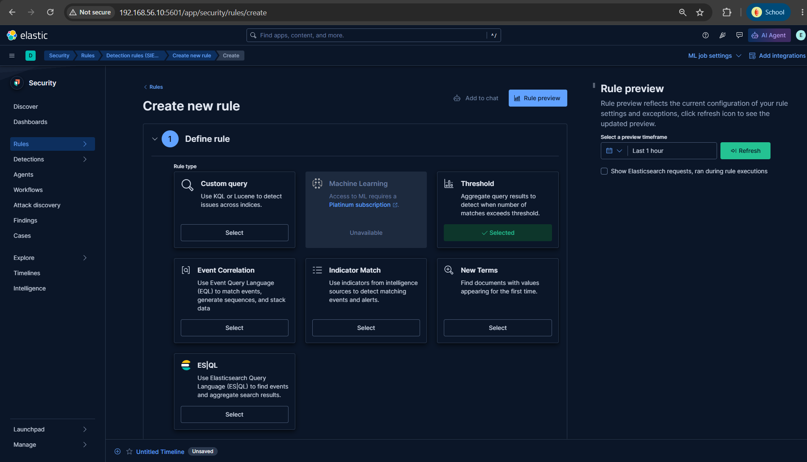
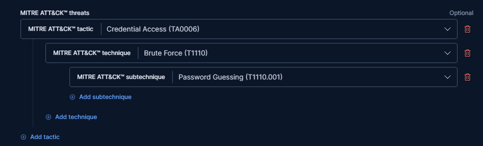
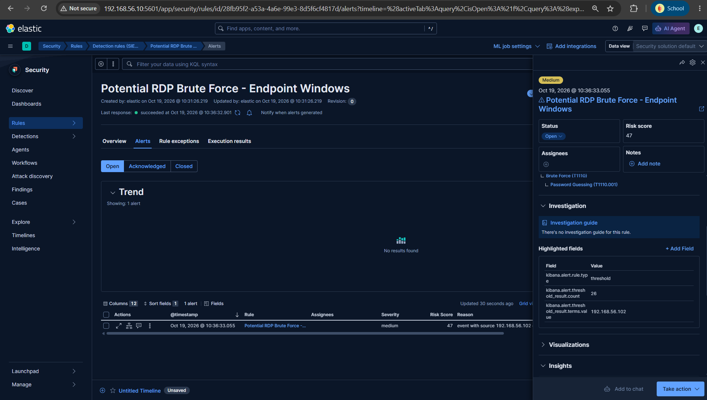

---

### Fase 4.7: Dashboard Visualisasi Windows

- **Masalah:** Melengkapi visibilitas serangan RDP sama seperti yang sudah dibangun untuk Linux.
- **Investigasi:** Dua panel Lens dibangun mengikuti pola yang sama dengan fase Linux: bar chart tren waktu (per menit, breakdown `source.ip`), dan pie chart top sumber IP.
- **Temuan:** Chart tren menunjukkan dua lonjakan jelas sesuai dua sesi serangan Hydra, didominasi `192.168.56.102` (86%), dengan sedikit noise dari `127.0.0.1` dan `192.168.56.1` (IP host Windows sendiri) — bukan bagian dari serangan, tapi tervisualisasi dengan jelas berkat breakdown per-IP. Dashboard berhasil disimpan, dikonfirmasi muncul di daftar Dashboards.
- **Kesimpulan:** Kedua endpoint (Linux dan Windows) kini memiliki dashboard deteksi brute force masing-masing dengan pola visualisasi yang konsisten.

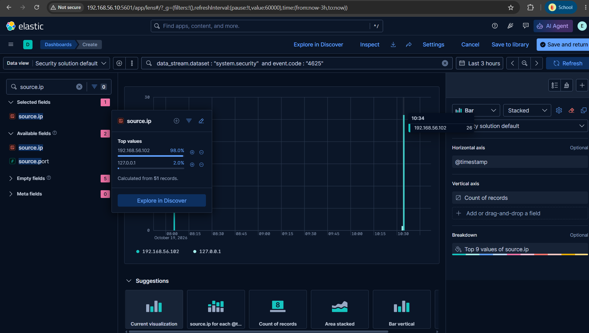
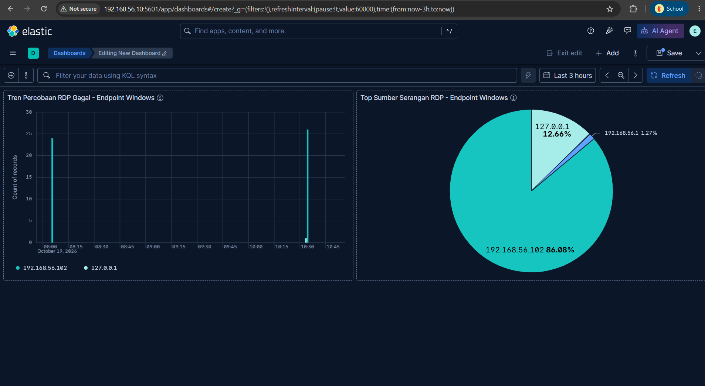
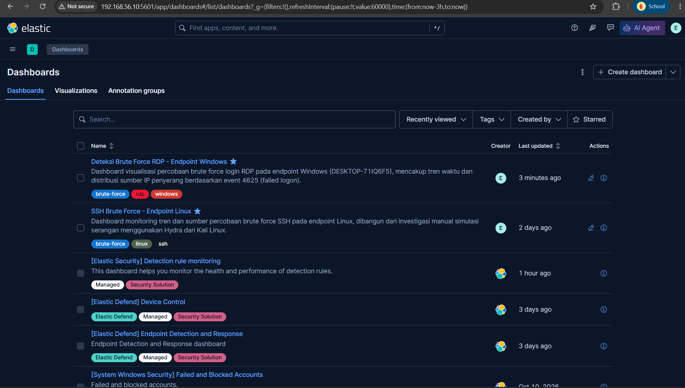

---

## Analisis Akar Masalah

- **Penyebab utama:** RDP tidak aktif secara default, dan Elastic Agent Windows tidak auto-start setelah VM lama tidak aktif (berbeda dari Linux) — kombinasi ini menunjukkan bahwa simulasi "serangan" pada fase ini sesungguhnya diawali dengan simulasi *membuka* celah akses dan memulihkan monitoring terlebih dahulu, representasi realistis dari skenario operasional di dunia nyata.
- **Faktor pendukung:** NLA/CredSSP yang aktif secara default pada RDP modern membuat tool-tool berbasis `rdesktop` (Crowbar, `rdesktop` manual) kesulitan, sehingga pemilihan tool yang tepat (Hydra dengan backend `freerdp` yang mendukung NLA) menjadi faktor penentu keberhasilan simulasi — bukan soal "kurang usaha", tapi soal kesesuaian tool dengan kontrol keamanan target.

---

## Penilaian Dampak

- **Sistem terdampak:** `DESKTOP-71IQ6F5` (simulasi lab).
- **Data yang mungkin terekspos:** Akses desktop penuh sebagai user `aufa` jika serangan ini nyata (dibuktikan lewat `xfreerdp`).
- **Jangkauan lateral movement:** Tidak diuji — scope dibatasi pada deteksi akses awal.

---

## Remediasi & Rekomendasi

**Tindakan segera (jika ini insiden nyata):**
- Putuskan sesi RDP aktif, reset kredensial user `aufa`, audit log untuk aktivitas pasca-logon.

**Jangka pendek:**
- Pertahankan Network Level Authentication (NLA) — kontrol inilah yang membuat `crowbar`/`rdesktop` gagal, jangan dilonggarkan.
- Batasi akses RDP hanya dari IP/subnet tertentu via firewall, bukan terbuka ke seluruh jaringan.

**Jangka panjang:**
- Pertimbangkan Multi-Factor Authentication (MFA) untuk akses RDP pada lingkungan produksi.
- Standardisasi threshold rule brute force Linux dan Windows ke pendekatan yang sama (saat ini berbeda: Custom query vs Threshold) agar lebih mudah dipelihara.

---

## Pelajaran yang Didapat

- Field Windows Event Log (`winlog.*`, `event.code`) memiliki struktur yang jauh lebih eksplisit dibanding log teks Linux (`message`) — `LogonType` secara khusus adalah kunci untuk membedakan jenis akses (RDP vs lokal vs jaringan vs service), sesuatu yang tidak memiliki padanan langsung di `auth.log` Linux. Namun berbeda dari Linux (di mana field hasil parsing seperti `event.action` tidak reliable), di Windows field terstruktur seperti `source.ip` justru terbukti akurat setelah divalidasi — kesimpulannya: validasi tetap wajib dilakukan tiap kali, tidak bisa diasumsikan reliable atau tidak reliable berdasarkan OS semata.
- Tool pentest lama tidak selalu kompatibel dengan kontrol keamanan modern (NLA/CredSSP) — kegagalan tool bukan berarti target tidak rentan, melainkan bisa jadi indikasi kontrol keamanan bekerja sebagaimana mestinya.
- Tipe rule Threshold di Kibana lebih sesuai secara konseptual untuk deteksi brute force dibanding Custom query manual (yang dipakai di fase Linux) — 26 kejadian individual menjadi 1 alert yang lebih bermakna, perbandingan langsung dua pendekatan ini jadi nilai tambah metodologis project.
- Di Windows, layanan dengan `StartType: Automatic` tetap bisa ditemukan `Stopped` setelah VM lama tidak aktif — berbeda dari asumsi umum bahwa "Automatic" berarti pasti auto-start, perlu verifikasi manual tiap sesi.

---

[← Fase Sebelumnya](03-detection-linux.md) | [README](README.md) | [Fase Berikutnya: Hasil & Kesimpulan →](05-hasil-dan-kesimpulan.md)
